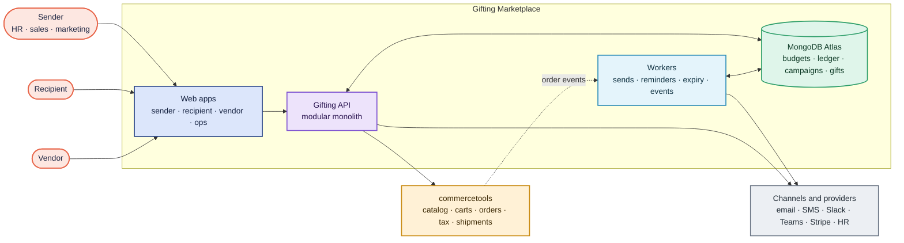

# Gifting Marketplace

**Corporate gifting on commercetools.** Companies fund team budgets and send
gifts by email, SMS, Slack, Teams, link or QR code. Recipients pick anything
they like from a curated, multi-brand collection within a budget, without
seeing prices. The vendor that owns the item ships it. Every dollar is held,
charged or released exactly once.

This is our commercetools practice's gifting accelerator, built first as an
8-week POC. It is benchmarked on Snappy-style corporate gifting and grew out of
a client's "choose your tin" requirements: that merchant is now one vendor
among several.

**Start here:** [Architecture overview](docs/architecture/overview.md) ·
[POC plan](docs/plans/poc-plan.md) ·
[Roadmap](docs/product/roadmap.md) ·
[Getting started](docs/engineering/getting-started.md) ·
[All documentation](docs/README.md)

## How it works



In one sentence: **commercetools owns the commerce; the platform owns the
entitlements and the money.** Products, prices, stock, carts, orders, tax and
shipments live in commercetools. Budgets, campaigns, gifts and the ledger live
in MongoDB. A redeemed gift becomes a real commercetools order with real
totals, paid by the company's balance, so vendors, finance and reporting see
true values while the recipient pays nothing.

## The rules that keep it safe

1. **One gift, one order.** An atomic lock on the gift, plus the unique order
   number `GFT-<giftId>`, means a gift can never produce two orders, even on a
   retry or a double click.
2. **Money moves exactly once.** The ledger is append-only. Every entry has a
   deterministic idempotency key, and balances are always computed, never
   edited.
3. **Nothing sends unfunded.** Holds are placed before a gift is sent; a
   campaign the balance can't cover never goes out.
4. **Prices never come from the browser.** The server re-checks the item, the
   country and the budget at claim time.
5. **Only the server holds credentials.** Browsers talk to the Gifting API
   only; commercetools and provider keys never leave the API and workers.

## Progress

| Area | Status |
| --- | --- |
| Architecture v2 and docs | ✅ Done |
| Monorepo scaffold: 4 apps, API, worker, shared packages, CI | ✅ Done (M0) |
| Week-1 spikes (company-balance order, catalog, tax, Business Units, channel approvals, concurrency) | Spike 2 (catalog) ✅ done; the others planned (M0) |
| Marketplace catalog from commercetools: products with variants and photos, collections by product search | ✅ Built, see the [plan](docs/plans/marketplace-catalog.md) |
| Accounts: register with email verification and sign in, on commercetools customer accounts (B2C) | ✅ Built (M1): real email through Brevo; commerce connectors (commercetools, memory) |
| Sender dashboard: Home, Browse gifts, Campaigns, send flow, approvals (ahead of M1 to M3, on seed data) | ✅ Built, see the [plan](docs/plans/sender-dashboard.md) |
| Accounts, teams and the ledger | Planned (M1) |
| Catalog and budget collections | Planned (M2) |
| Campaigns, approvals, holds, email, links, QR | Planned (M3) |
| Redemption, vendor routing and tracking | Planned (M4) |
| Automation and more channels | Planned (M5) |
| Statements, reconciliation and reporting | Planned (M6) |
| Hardening and the demo | Planned (M7) |

## Repository layout

```
apps/        sender · recipient · vendor · ops        (Next.js)
services/    api (Fastify, modules per domain) · worker
packages/    domain · db · ledger · ct · channels · logger · ui
infra/       ct-setup (store, channels, types, subscription) · seed (fictional vendors and products)
docs/        product · architecture · engineering · plans · technical · business
```

## Commands

```bash
pnpm install
pnpm dev          # every app and the API
pnpm lint
pnpm typecheck
pnpm test
pnpm build
```

Details, ports and environment setup are in
[getting started](docs/engineering/getting-started.md). Coding agents read
[CLAUDE.md](CLAUDE.md) first.
