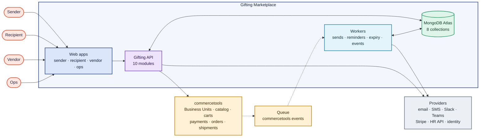

# Gifting Marketplace documentation

The Gifting Marketplace is a corporate gifting platform on commercetools.
Companies fund team budgets and send gifts through many channels. Recipients
pick from a multi-brand collection within a budget, and vendors ship what was
chosen. Money is held, charged and released exactly once.

Every document marks what is **Built** today and what is **Planned**. When the
code and a document disagree, the code is right and the document needs fixing.

## Map

| Folder | Read it when you want to know… | Documents |
| --- | --- | --- |
| [product/](product/) | what we are building, for whom, and in what order | [Vision](product/vision.md) · [Personas](product/personas.md) · [Features](product/features.md) · [Roadmap](product/roadmap.md) · [Glossary](product/glossary.md) |
| [architecture/](architecture/) | how the system fits together and why | [Overview](architecture/overview.md) · [Data model](architecture/data-model.md) · [commercetools design](architecture/commercetools.md) · [Money and the ledger](architecture/money-and-ledger.md) · [Key flows](architecture/flows.md) · [Channels and integrations](architecture/integrations.md) · [Security](architecture/security.md) · [Decisions](architecture/decisions/) |
| [design/](design/) | how the apps look and behave | [Design system](design/design-system.md) |
| [engineering/](engineering/) | how to work in the codebase | [Getting started](engineering/getting-started.md) · [Conventions](engineering/conventions.md) · [Testing](engineering/testing.md) · [Git workflow](engineering/git-workflow.md) · [Build log](engineering/build-log.md) |
| [plans/](plans/) | what each step set out to build, and what was built | [Plans](plans/README.md) · [POC plan](plans/poc-plan.md) · [Spikes](plans/spikes.md) |
| [technical/](technical/) | how it is configured, deployed and run | [Configuration](technical/configuration.md) · [API](technical/api.md) · [Deployment](technical/deployment.md) · [Operations](technical/operations.md) |
| [business/](business/) | why it exists and what is still undecided | [Benchmark and positioning](business/positioning.md) · [Open questions](business/open-questions.md) |
| [reference/](reference/) | the source documents | [Architecture v2 (Word)](reference/Gifting-Marketplace-POC-Architecture-v2.docx) |

## The system on one page

Solid arrows are calls; dashed arrows are events. The full picture, module by
module, is in the [architecture overview](architecture/overview.md).

## Keeping docs current

- Change the doc in the same pull request as the code it describes.
- New architectural choices get a decision record in
  [architecture/decisions/](architecture/decisions/).
- Diagrams are Mermaid inside Markdown, so they diff and review like code.
  Colour key: coral = people · navy = apps · violet = Gifting API · teal =
  workers · green = MongoDB · amber = commercetools · grey = external.
