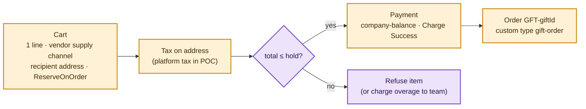

# commercetools design

commercetools has no built-in marketplace, so vendors are modelled as supply
Channels plus a product attribute, and the platform does the routing.
Redemption orders carry real totals and are paid by a custom company-balance
Payment ([ADR 0005](decisions/0005-company-balance-payment.md),
[ADR 0006](decisions/0006-vendors-as-supply-channels.md)).

**Status:** drafts for the store, channels and custom types are scaffolded
in `infra/ct-setup` (`pnpm ct:plan`). Spikes 1, 2 and 4 prove the rest in
week 1.

## Project layout

| Concern | Design |
| --- | --- |
| Project and store | One project for the marketplace with a `gifting` Store; later, one store per country |
| Companies and teams | Business Units: one Company per customer, one Division per team. Associates and Associate Roles for owner, admin, sender and approver |
| Vendors | One supply Channel per vendor (role `InventorySupply`), custom type `vendor`: contacts, fulfilment method, SLA |
| Products | Every variant has `brand`, `vendorKey` and `tags` attributes; stock per vendor channel; one price per country in USD for the POC |
| Catalog import | Vendor feeds or CSV into the Import API; seed 3 to 5 vendors and 50 to 100 products |
| Collections | Rules resolved with product search: tags, brands, SKUs, price range, country, in stock at the vendor channel |
| Cart | Created only by the API in the gifting store: one line item, quantity 1, with the vendor's supply channel, the recipient's address, the marketplace shipping method, `inventoryMode: ReserveOnOrder` |
| Tax | On the recipient's address. POC: platform tax with rates for the seeded states. Production: External tax mode with a tax provider (spike 3) |
| Payment | Method `company-balance`, amount = cart total, one successful `Charge` transaction whose interaction id is the ledger capture key |
| Order | `orderNumber` `GFT-<giftId>` (unique: no second order per gift); custom type `gift-order`: `giftId`, `campaignId`, `companyKey`, `teamKey`, `vendorKey` |
| Shipments | Deliveries and Parcels with tracking added by Fulfillment; shipment state set on the order |
| Subscriptions | `OrderCreated`, `OrderStateChanged`, `OrderShipmentStateChanged`, delivery and parcel messages to a Google Cloud Pub/Sub topic; deduplicated by message id |

## The redemption order

The recipient never sees a payment step. The Payment records that the
company's balance paid; the money itself moves in our ledger, in the same
transaction that marks the gift redeemed.

## Custom types

| Key | Resource | Fields |
| --- | --- | --- |
| `vendor` | Channel | `contactEmail`, `fulfilmentMethod` (portal, email, api), `slaDays` |
| `gift-order` | Order | `giftId`, `campaignId`, `companyKey`, `teamKey`, `vendorKey` |
| `company-settings` | Business Unit | `brandColor`, `logoUrl`, `retentionDays`, `allowOverage` |
| `team-settings` | Business Unit | `approvalThresholdCents`, `approverIds` |

The drafts are in [`infra/ct-setup/src/drafts.ts`](../../infra/ct-setup/src/drafts.ts).

## API clients and scopes

No client in a browser. Each runs with only the scopes it needs.

| Client | Used by | Scopes |
| --- | --- | --- |
| `gifting-api` | `services/api` | `manage_orders`, `manage_payments`, `view_products`, `view_published_products`, `manage_business_units`, `manage_associate_roles`, `view_channels` |
| `gifting-events` | `services/worker` | `view_orders`, `manage_orders` (shipment state, deliveries) |
| `gifting-import` | `infra/seed` | `manage_import_containers`, `manage_products`, `manage_channels` |
| `gifting-setup` | `infra/ct-setup` | `manage_project` (sandbox only; never in a deployed environment) |

The scopes are a starting list, confirmed in spike 4 and narrowed where
possible.

## Spikes that settle this design

| # | Proves |
| --- | --- |
| 1 | An order with real totals and a company-balance Payment with a successful Charge, with no payment step for the recipient |
| 2 | Product search returns a budget collection across 3 vendors by tag, brand, price and stock per vendor channel |
| 3 | Tax on the recipient's address is right for the seeded states |
| 4 | Company and Division units with associate roles drive what each member can see and do |

Details and results: [spikes](../plans/spikes.md).
