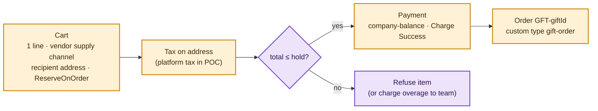

# commercetools design

commercetools has no built-in marketplace, so vendors are modelled as supply
Channels plus a product attribute, and the platform does the routing.
Redemption orders carry real totals and are paid by a custom company-balance
Payment ([ADR 0005](decisions/0005-company-balance-payment.md),
[ADR 0006](decisions/0006-vendors-as-supply-channels.md)).

**Status (28 Oct 2026):** the POC project `corporate-gifting` (us-central1)
has everything below except the subscription, and a cart can be priced end to
end.

| What | Count | Made by |
| --- | --- | --- |
| Store `gifting` (US, en-US), with all 5 vendor channels as supply channels | 1 | `pnpm ct:apply` |
| Custom types: `vendor`, `gift-order`, `company-settings`, `team-settings`, `company-balance-payment` | 5 | `pnpm ct:apply` |
| Product types `gift-item` and `cookie-tin`, sharing the marketplace and gifting attributes | 2 | `pnpm ct:apply` |
| Tax category `standard`: demo base rates for the 10 seeded states, plus a 6% US fallback | 11 rates | `pnpm ct:apply` |
| Zone `us` and shipping method `vendor-standard` ($8.00 flat, default) | 1 each | `pnpm ct:apply` |
| Associate roles `owner`, `admin`, `approver`, `sender` | 4 | `pnpm ct:apply` |
| Gift categories under `gifts`: food and treats, drinks, home, outdoors, wellness | 6 | `pnpm ct:apply` |
| Vendor supply channels (4 fictional, Christie Cookie) | 5 | `ct:apply`, `catalog:import` |
| Products, all published, taxed, in a gift category, with descriptions and gifting attributes | 261 (12 fictional, 249 Christie Cookie) | `pnpm seed`, `pnpm catalog:import` |
| Christie Cookie variants and images; their categories under `christie-cookie` | 441 variants, 1,369 images, 51 categories | `pnpm catalog:import` |
| Stock entries at the vendor channels | 453 | `pnpm seed`, `pnpm catalog:import` |
| Demo customers (`ExternalAuth`, US addresses) | 250 | `pnpm seed` |
| Business Units: 5 fictional companies, each with 2 teams; every customer an associate with a role | 15 units, 250 associates | `pnpm seed` |

- **Check:** a test cart for `CC-2585` ($57.00) to Nashville, TN gave $8.00
  shipping, 7% tax ($4.55) and $69.55 in total. The cart was deleted
  afterwards.
- **Not yet:**
  - the subscription to a queue (M4);
  - narrow API clients (an admin creates them in the Merchant Center; the
    scopes are listed below);
  - real stock numbers for Christie Cookie;
  - images for the 12 fictional products.
- **Tax rates are demo values:** state base rates only, not tax advice.
  Spike 3 chooses a tax service for production.
- **Recipients aren't commerce customers:** they stay in MongoDB (ADR 0002).

## Project layout

| Concern | Design |
| --- | --- |
| Project and store | One project for the marketplace with a `gifting` Store; later, one store per country |
| Companies and teams | Business Units: one Company per customer, one Division per team. Associates and Associate Roles for owner, admin, sender and approver |
| Vendors | One supply Channel per vendor (role `InventorySupply`), custom type `vendor`: contacts, fulfilment method, SLA |
| Products | Every variant has `brand`, `vendorKey` and `tags` attributes; stock per vendor channel; one price per country in USD for the POC |
| Catalog import | Vendor feeds, CSV or a storefront snapshot into the Import API (`infra/catalog`, `infra/seed`); product types `gift-item` and `cookie-tin` share the `brand`, `vendorKey` and `tags` attributes |
| Collections | Rules resolved with one product search ([spike 2](../plans/spikes.md#spike-2-marketplace-catalog)): any of the tags, brands or SKUs; `variants.prices.centAmount` within the budget; and, per vendor, `vendorKey` with `isOnStockForChannel` at that vendor's channel. Search returns ids and matching variants; details come from the cached listing (`packages/ct/src/catalog.ts`) |
| Catalog reads | The API lists published product projections (US price, stock per channel), cached for 60 s, and reads a single SKU live when it estimates or sends. Each product is one card with its variants |
| Cart | Created only by the API in the gifting store: one line item, quantity 1, with the vendor's supply channel, the recipient's address, the marketplace shipping method, `inventoryMode: ReserveOnOrder` |
| Tax | On the recipient's address. POC: platform tax with rates for the seeded states. Production: External tax mode with a tax provider (spike 3) |
| Payment | Method `company-balance`, amount = cart total, one successful `Charge` transaction whose interaction id is the ledger capture key |
| Order | `orderNumber` `GFT-<giftId>` (unique: no second order per gift); custom type `gift-order`: `giftId`, `campaignId`, `companyKey`, `teamKey`, `vendorKey` |
| Shipments | Deliveries and Parcels with tracking added by Fulfillment; shipment state set on the order |
| Subscriptions | `OrderCreated`, `OrderStateChanged`, `OrderShipmentStateChanged`, delivery and parcel messages to a Google Cloud Pub/Sub topic; deduplicated by message id |

## The redemption order

The recipient never sees a payment step. The Payment records that the
company's balance paid; the money itself moves in our ledger, in the same
transaction that marks the gift redeemed.

## Custom types

| Key | Resource | Fields |
| --- | --- | --- |
| `vendor` | Channel | `contactEmail`, `fulfilmentMethod` (portal, email, api), `slaDays` |
| `gift-order` | Order | `giftId`, `campaignId`, `companyKey`, `teamKey`, `vendorKey` |
| `company-settings` | Business Unit | `brandColor`, `logoUrl`, `retentionDays`, `allowOverage` |
| `team-settings` | Business Unit | `approvalThresholdCents`, `approverIds` |
| `company-balance-payment` | Payment | `captureKey` (the ledger capture key), `giftId`, `companyKey`, `teamKey` |

The drafts are in [`infra/ct-setup/src/drafts.ts`](../../infra/ct-setup/src/drafts.ts).

## API clients and scopes

No client in a browser. Each runs with only the scopes it needs.

| Client | Used by | Scopes |
| --- | --- | --- |
| `gifting-api` | `services/api` (`CTP_API_*`; read-only `view_published_products`, `view_products` until M4) | `manage_orders`, `manage_payments`, `view_products`, `view_published_products`, `manage_business_units`, `manage_associate_roles` (channels are readable with `view_products`) |
| `gifting-events` | `services/worker` | `view_orders`, `manage_orders` (shipment state, deliveries) |
| `gifting-import` | `infra/seed` | `manage_import_containers`, `manage_products`, `manage_channels` |
| `gifting-setup` | `infra/ct-setup` | `manage_project` (sandbox only; never in a deployed environment) |

The scopes are a starting list, confirmed in spike 4 and narrowed where
possible.

## Spikes that settle this design

| # | Proves |
| --- | --- |
| 1 | An order with real totals and a company-balance Payment with a successful Charge, with no payment step for the recipient |
| 2 | Product search returns a budget collection across 3 vendors by tag, brand, price and stock per vendor channel |
| 3 | Tax on the recipient's address is right for the seeded states |
| 4 | Company and Division units with associate roles drive what each member can see and do |

Details and results: [spikes](../plans/spikes.md).
