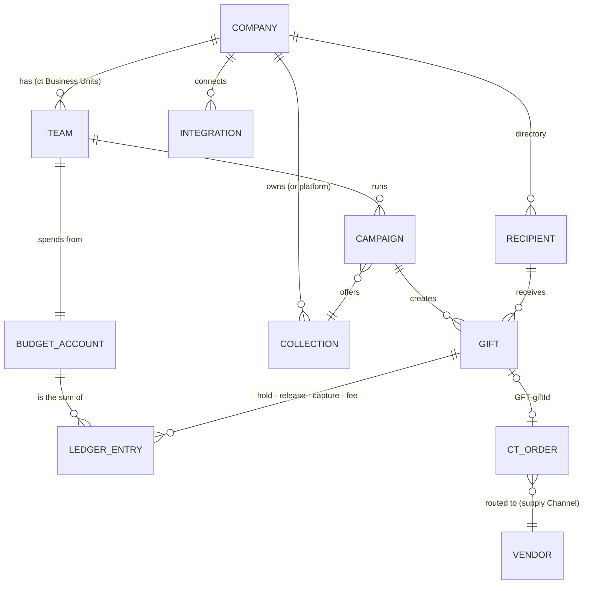
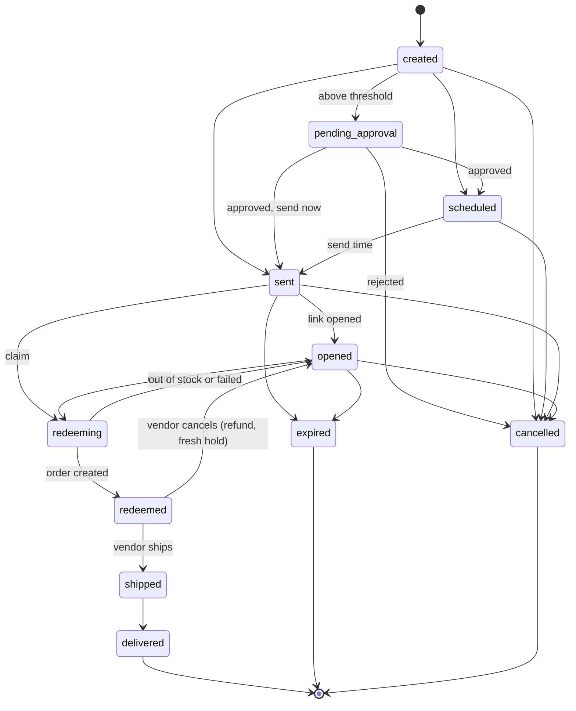

# Data model

All MongoDB shapes are Zod schemas in
[`packages/domain/src/models.ts`](../../packages/domain/src/models.ts);
TypeScript types are inferred from them. Indexes live in
[`packages/db/src/indexes.ts`](../../packages/db/src/indexes.ts).

**Status:** schemas and indexes scaffolded (M0); no module reads or writes
them yet.

## The rule

MongoDB holds only what commercetools can't
([ADR 0002](decisions/0002-mongodb-for-platform-data.md)). Companies, teams,
vendors, products, orders, addresses and shipments stay in commercetools;
MongoDB keeps their keys (`companyKey`, `teamKey`, `vendorKey`,
`ctOrderNumber`), never copies.

## Ownership classes

| Class | Collections | Rule |
| --- | --- | --- |
| **Money** | `accounts`, `ledgerEntries` | Accounts change rarely. Ledger entries are append-only: insert only, never update or delete. |
| **Gifting** | `collections`, `campaigns`, `gifts` | Owned by the platform. Gifts change only through the state machine, with a `version` counter. |
| **Personal** | `recipients` | Personal fields are encrypted at rest and purged after the company's retention period. |
| **Integration** | `integrations` | Connection status and a `secretRef`; never the secret itself. |
| **Plumbing** | `processedEvents` | One document per handled commercetools message; TTL 30 days. |

## Entities

`COMPANY`, `TEAM`, `VENDOR` and `CT_ORDER` live in commercetools.

## Collections

| Collection | Holds | Key indexes |
| --- | --- | --- |
| `accounts` | `companyKey`, `teamKey`, `currency`, `billingMethod` (prepaid or invoice), `creditLimitCents`, `stripeCustomerId` | unique `teamKey` |
| `ledgerEntries` | `accountId`, `type`, `amountCents`, `currency`, `giftId`, `campaignId`, `idempotencyKey`, `reason`, `createdAt`, `createdBy` | unique `idempotencyKey`; `{accountId, createdAt}`; `{giftId}` |
| `collections` | `owner` (`platform` or a `companyKey`), `name`, `rules` (tags, brands, SKUs, pinned), `countries`, `budgetBandCents` | `{owner, name}` |
| `recipients` | `companyKey`, `teamKey`, `name`, `email`, `emailLower`, `phone`, `slackId`, `teamsId`, `birthdayMonthDay`, `startDate`, `startMonthDay`, `source`, `externalId` | unique `{companyKey, emailLower}`; `{companyKey, birthdayMonthDay}`; `{companyKey, startMonthDay}` |
| `campaigns` | `companyKey`, `teamKey`, `type`, `status`, `collectionId` or `sku`, `budgetCents`, `channels`, `branding`, `message`, `expiresInDays`, `approval`, `trigger`, `sendAt` | `{teamKey, status}`; `{type, status}` |
| `gifts` | `companyKey`, `teamKey`, `campaignId`, `recipientId`, `occurrence`, `budgetCents`, `holdCents`, `tokenHash`, `codeHash`, `status`, `version`, `expiresAt`, `claim`, `notifications`, `ctOrderNumber` | unique `tokenHash`; unique `codeHash`; unique `{campaignId, recipientId, occurrence}`; `{status, expiresAt}`; `{teamKey, status}` |
| `integrations` | `companyKey`, `type` (hris, slack, teams), `status`, `secretRef`, `lastSyncAt` | unique `{companyKey, type}` |
| `processedEvents` | `_id` = commercetools message id, `receivedAt` | TTL 30 days on `receivedAt` |

## Gift statuses

The allowed moves are `canTransition()` in
[`packages/domain/src/gift-status.ts`](../../packages/domain/src/gift-status.ts),
with unit tests. `shipped` and `delivered` are mirrored from the commercetools
order so dashboards don't need to call commercetools.

## Exactly-once rules

| Risk | Guard |
| --- | --- |
| Two orders for one gift | `findOneAndUpdate` from `sent`/`opened` to `redeeming` (the lock is in the filter), and the unique commercetools order number `GFT-<giftId>` |
| Money moved twice | Unique `idempotencyKey` on `ledgerEntries`, built by `ledgerKeys` (`hold:<giftId>:<holdNo>`, `capture:<giftId>:<holdNo>`, …) |
| Second birthday gift in a year | Unique `{campaignId, recipientId, occurrence}` on `gifts` |
| Gift and money disagree | Gift status and its ledger entries in one multi-document transaction |
| Duplicate commercetools event | Insert into `processedEvents` first; a duplicate key means skip |

## Money fields

All amounts are integer cents with an ISO currency (USD in the POC). There
are no floats anywhere money is stored or compared. See
[money and the ledger](money-and-ledger.md).
