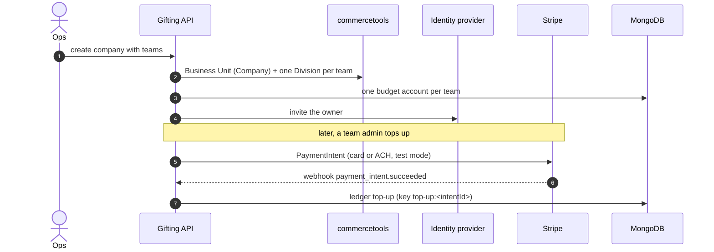
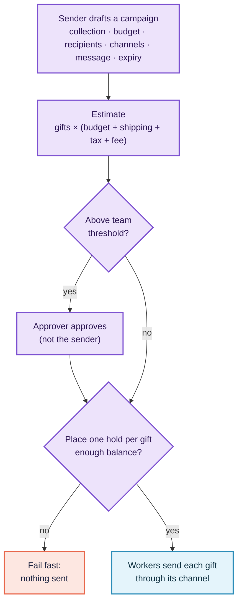
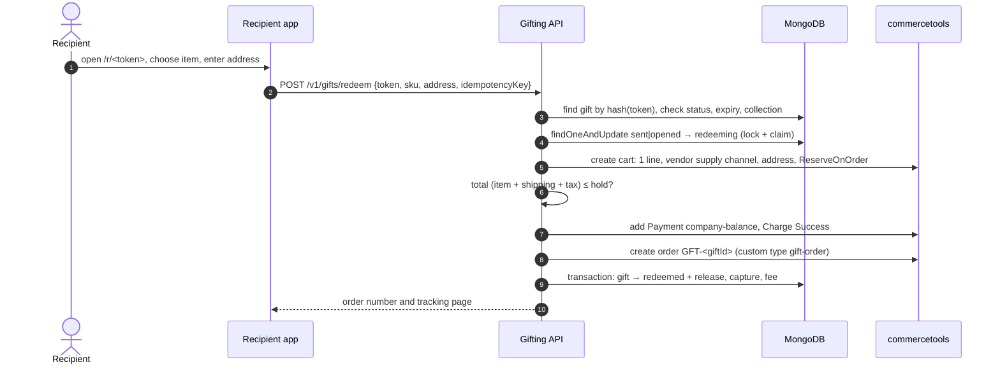

# Key flows

**Status:** all planned. Each section names its milestone.

## Onboarding and funding (M1)



Invoice-billed teams get a credit limit instead of a top-up.

## Budget collections (M2)

1. A sender picks a platform collection or builds one: tags, brands, explicit
   SKUs, pinned items, a budget band (for example $50) and countries.
2. The API resolves the rules with commercetools product search in the
   gifting store: price within budget for the recipient's country, in stock
   at the vendor's channel, vendor active.
3. Results are cached per collection, country and budget for about an hour;
   every item is re-checked live at claim time.

## Campaigns, approvals and automation (M3, M5)



**Automated campaigns:** a daily worker finds directory recipients with a
birthday, work anniversary or start date coming up, and creates one gift per
occurrence. The unique index on campaign, recipient and occurrence makes this
idempotent. From there it follows the hold and send steps above. A nightly
HR-system sync keeps the directory current.

## Redemption (M4)



- **Step 4** guarantees one order per gift. If it returns `null`, someone else
  is already redeeming, or the gift is redeemed, expired or cancelled.
- **Step 6** guarantees the company never pays more than it held. If it fails,
  the item is refused, or the overage is charged to the team where allowed.
- **Step 8:** if commercetools returns `OutOfStock`, the gift returns to
  `opened` and the recipient chooses again.
- **Step 9** writes the gift status and its release, capture and fee entries
  in one MongoDB transaction.
- A crash between steps 8 and 9 leaves the gift in `redeeming`. The
  `stuck-claim-reconciler` looks up `GFT-<giftId>`. If the order exists, it
  finishes step 9; if not, it rolls the gift back to `opened`.

The core of step 4:

```ts
const gift = await gifts.findOneAndUpdate(
  { _id: giftId, status: { $in: ["sent", "opened"] }, expiresAt: { $gt: now } },
  {
    $set: { status: "redeeming", claim: { sku, idempotencyKey, status: "pending", startedAt: now } },
    $inc: { version: 1 },
  },
  { returnDocument: "after" },
);
// null => already redeeming, redeemed, expired or cancelled
```

## Vendor fulfilment (M4)

```mermaid
sequenceDiagram
  autonumber
  participant CT as commercetools
  participant Q as Queue
  participant W as Worker (ct-events)
  participant DB as MongoDB
  actor V as Vendor
  participant API as Gifting API
  CT-->>Q: OrderCreated
  Q-->>W: message
  W->>DB: insert processedEvents (duplicate → skip)
  W->>V: email + order in vendor portal (by line item supply channel)
  V->>API: mark shipped (carrier, tracking)
  API->>CT: add Delivery + Parcel with tracking; shipmentState Shipped
  CT-->>Q: OrderShipmentStateChanged
  Q-->>W: message
  W->>DB: gift → shipped; notify recipient and sender
```

In the POC the vendor also marks delivery; later a tracking aggregator does
it automatically. If the vendor can't ship, the order is cancelled, a
`refund` reverses the capture, and the gift reopens with a fresh hold.

## Expiry and reminders (M3, M6)

- Reminders go out on the company's cadence (for example day 3, day 7, then
  7 days and 1 day before expiry) for email, SMS, Slack and Teams, and stop
  at redemption. Links and QR codes get no reminders.
- The `expiry` job moves gifts past `expiresAt` from `sent` or `opened` to
  `expired` and writes the `release`, in one transaction per gift.
