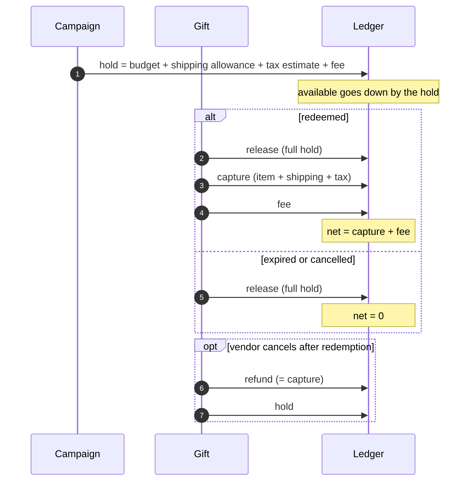

# Money and the ledger

The two things that must never go wrong are a gift producing two orders and
money moving twice. This page covers the money side; the order side is in
[key flows](flows.md#redemption).

**Status:** the balance rule and entry builders are scaffolded with tests in
[`packages/ledger`](../../packages/ledger/src/). Writing entries arrives in
M1 (top-ups), M3 (holds), M4 (capture) and M6 (expiry, refunds, statements).

## Rules

1. **Integer cents.** Every amount is `amountCents` (a positive integer) with
   a `currency`. The entry `type` gives the direction; amounts are never
   negative.
2. **Append-only.** Entries are inserted, never updated or deleted. Mistakes
   are corrected with an `adjustment` that carries a reason and the ops user.
3. **Deterministic idempotency keys.** Each entry's key comes from what it is
   for, not from a random id, so a retried job builds the same key and the
   unique index refuses the duplicate.
4. **Computed balances.** No balance field exists anywhere. The balance is
   always the sum of the account's entries.
5. **One transaction.** A gift's status change and its ledger entries commit
   together, or not at all.

## Entry types

| Type | Direction | Written when | Idempotency key |
| --- | --- | --- | --- |
| `top-up` | + | Stripe payment succeeded, or invoice paid | `top-up:<stripePaymentIntentId>` |
| `hold` | − (until released) | Campaign approved or gift created | `hold:<giftId>:<holdNo>` |
| `release` | + (undoes a hold) | Gift redeemed, expired or cancelled | `release:<giftId>:<holdNo>` |
| `capture` | − | Gift redeemed | `capture:<giftId>:<holdNo>` |
| `fee` | − | Gift redeemed | `fee:<giftId>:<holdNo>` |
| `refund` | + | Vendor cancelled a redeemed order | `refund:<giftId>:<holdNo>` |
| `adjustment` | + or − (`direction` field) | Ops correction | `adjustment:<uuid>` (one per ops action) |

`holdNo` starts at 1 and goes up each time a gift is re-held after a vendor
cancellation, so a reopened gift gets fresh keys.

## The balance rule

```
available = top-ups + credit limit + refunds + adjustments(+)
          − open holds − captures − fees − adjustments(−)

open holds = holds − releases
```

A redeemed gift releases its full hold and then captures the real cost plus
the fee. So it nets to exactly capture + fee, whatever the budget was.

`computeBalance()` in
[`packages/ledger/src/balance.ts`](../../packages/ledger/src/balance.ts)
implements this. Its tests cover every lifecycle below.

## Lifecycle



| Event | Ledger entries |
| --- | --- |
| Campaign approved or gift created | `hold` = budget + shipping allowance + tax estimate + fee |
| Gift redeemed | `release` = full hold; `capture` = item + shipping + tax; `fee` |
| Gift expired or cancelled | `release` = full hold |
| Order cancelled by vendor | `refund` = captured amount; gift reopens with a fresh `hold` |
| Month end | Statement per account; invoice-billed accounts get an invoice |

## Worked example

A $50 gift with a $10 shipping allowance, $5 tax estimate and $3 fee. The
recipient picks a $42 item; shipping is $8 and tax $3.

| Step | Entry | Amount | Available after (from $1,000) |
| --- | --- | --- | --- |
| Approved | hold | 68.00 | 932.00 |
| Redeemed | release | 68.00 | 1,000.00 |
| Redeemed | capture | 53.00 | 947.00 |
| Redeemed | fee | 3.00 | 944.00 |

Net cost: $56. Without the true-up the company would have paid $68.

## Guards

| Guard | Where |
| --- | --- |
| Holds before sending: a campaign that can't be covered never sends | Campaigns, on approval |
| Total must fit the hold, or the item is refused (or overage charged to the team when the company allows it) | Gifts, before creating the order |
| Approvals above each team's threshold; the approver can't be the sender | Campaigns |
| Hourly reconciliation: open holds against gifts that still hold money (`scheduled`, `sent`, `opened`, `redeeming`); captures against commercetools order totals | Worker `ledger-reconciliation` |
| Production database user for the ledger has insert and find only | Deployment |

## Billing

Prepaid accounts top up by card or ACH (Stripe test mode in the POC); the
webhook writes `top-up`. Invoice-billed accounts have a `creditLimitCents`
instead and receive a monthly invoice built from the statement. Statements
list every entry for the month with opening and closing balances.
