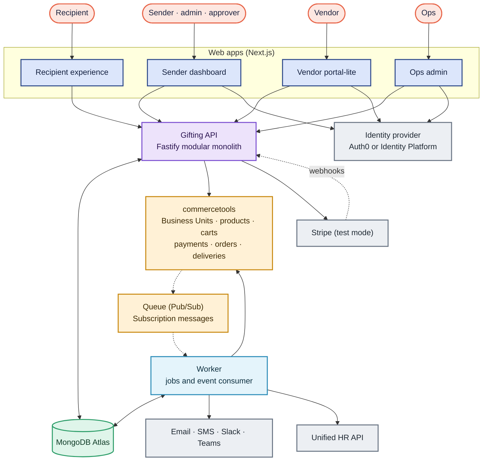
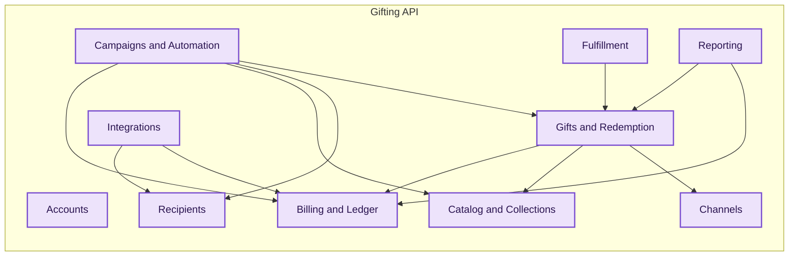

# Architecture overview

Colour key used in every diagram: coral = people · navy = apps · violet =
Gifting API · teal = workers · green = MongoDB · amber = commercetools · grey =
external services. Dashed arrows are events.

**Status:** agreed (architecture v2, 27 Oct 2026). The monorepo scaffold is
built; every module below is planned. The source document is
[Architecture v2 (Word)](../reference/Gifting-Marketplace-POC-Architecture-v2.docx).

## Principles

1. **commercetools owns commerce.** Catalog, prices, stock, carts, orders, tax
   and shipments. The platform owns entitlements and money: budgets,
   campaigns, gifts, the ledger ([ADR 0001](decisions/0001-commerce-in-commercetools.md)).
2. **Real totals.** A redemption order carries real amounts, paid by the
   company's balance, so vendors, finance and reporting see true values
   ([ADR 0005](decisions/0005-company-balance-payment.md)).
3. **Exactly once.** Every state change and every ledger movement is
   idempotent and concurrency-safe ([ADR 0007](decisions/0007-append-only-ledger.md)).
4. **Adapters at the edges.** Channels, HR systems, vendors and payment
   providers sit behind interfaces ([ADR 0008](decisions/0008-channel-adapters.md)).
5. **A modular monolith.** One API with clear modules and separate workers, so
   modules can be split out later if load demands it
   ([ADR 0004](decisions/0004-modular-monolith.md)).

## System context

Every app talks only to the Gifting API. Only the platform calls
commercetools and the external services, and commercetools events come back
through a queue.

The recipient app uses no identity provider; the gift token is the
credential.

## Apps

| App | Users | What it does | Status |
| --- | --- | --- | --- |
| Sender dashboard | Owner, admin, sender, approver | Teams and budgets, collections, campaigns, recipients, approvals, billing, reports | Scaffolded |
| Recipient experience | Recipients | Unwrap, browse the collection (no prices), choose a variant, enter address, track the order | Scaffolded |
| Vendor portal-lite | Vendor staff | Orders to fulfil, mark shipped with tracking, CSV export | Scaffolded |
| Ops admin | Platform operator | Companies, vendors, collection curation, refunds and adjustments | Scaffolded |

## Gifting API modules

Arrows show which module's service another module may call. A module never
reads another module's collections.

| Module | Responsibility | Folder |
| --- | --- | --- |
| Accounts | Companies, teams, members and roles; mirrors company and teams as commercetools Business Units | `modules/accounts` |
| Billing and Ledger | Balances, top-ups, holds, captures, releases, fees, statements; Stripe adapter | `modules/ledger` |
| Catalog and Collections | Collection rules resolved through commercetools product search | `modules/catalog` |
| Campaigns and Automation | One-time, scheduled and automated campaigns; approvals; milestone triggers | `modules/campaigns` |
| Recipients | Company recipient directory | `modules/recipients` |
| Gifts and Redemption | Tokens, gift state machine, claim, cart and order with the company-balance payment | `modules/gifts` |
| Fulfillment | Routes each order to its vendor, receives tracking, writes deliveries to the order | `modules/fulfillment` |
| Channels | Email, SMS, Slack, Teams, links and QR behind one interface; reminders | `modules/channels` |
| Integrations | HR-system connector, Slack and Teams installs, Stripe webhooks | `modules/integrations` |
| Reporting | Gift funnel, spend by team and campaign, delivery status, exports | `modules/reporting` |

## Workers

| Job | When | Does |
| --- | --- | --- |
| `campaign-send` | At the campaign's send time | Sends each gift through its channel; records the notification |
| `milestone-automation` | Daily | Creates gifts for upcoming birthdays, anniversaries and start dates |
| `reminders` | Hourly | Sends due reminders; stops at redemption |
| `expiry` | Hourly | Expires gifts past `expiresAt` and releases their holds |
| `stuck-claim-reconciler` | Every 5 minutes | Finishes or rolls back claims stuck in `redeeming` (looks up `GFT-<giftId>`) |
| `ledger-reconciliation` | Hourly | Open holds against live gifts; captures against order totals; alerts |
| `statements` | Monthly | One statement per account; invoices for invoice-billed accounts |
| `ct-events` | Continuous | Consumes the commercetools queue; dedupes; routes orders, updates shipment status |
| `hr-sync` | Nightly | Syncs the recipient directory from the HR system |

## Packages

| Package | Holds | Imported by |
| --- | --- | --- |
| `@gifting/domain` | Zod models for the 8 collections, money helpers, gift state machine, idempotency keys | everything |
| `@gifting/ledger` | Ledger entry builders and the balance rule (pure) | api, worker |
| `@gifting/db` | MongoDB client, typed collections, indexes, test-database guard | api, worker, infra |
| `@gifting/ct` | commercetools client, order number and draft helpers | api, worker, infra |
| `@gifting/channels` | `Channel` interface, registry, adapters | api, worker |
| `@gifting/logger` | Structured logger with redaction | servers, scripts |
| `@gifting/ui` | Every shadcn/ui component, our composed ones, and the shared stylesheet ([ADR 0012](decisions/0012-shadcn-ui.md)) | apps |

Apps may import only `@gifting/domain` and `@gifting/ui`.

## Where data lives

| Data | Home |
| --- | --- |
| Companies, teams, members' roles | commercetools Business Units and Associates |
| Vendors | commercetools supply Channels |
| Products, prices, stock | commercetools catalog |
| Carts, orders, payments, tax, shipments, addresses | commercetools |
| Budget accounts, ledger, collections, recipients, campaigns, gifts, integrations, processed events | MongoDB ([data model](data-model.md)) |
| Identities | Identity provider |
| Provider secrets | Secrets manager (`integrations` keeps only a reference) |

## Deployment

Local: Docker Compose (MongoDB Atlas Local, Mailpit) and a commercetools
sandbox project. POC cloud: Google Cloud in `us-central1`
([ADR 0014](decisions/0014-google-cloud.md)). The apps, API and worker run
on Cloud Run, with MongoDB Atlas on GCP and Pub/Sub for commercetools
subscriptions. See [deployment](../technical/deployment.md).
