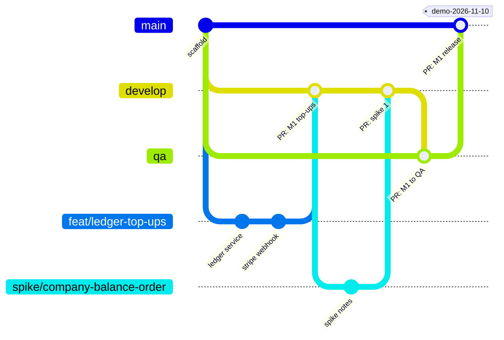

# Git workflow

Repository: [royal-cyber-inc/corporate-gifting](https://github.com/royal-cyber-inc/corporate-gifting).

## Branches

Work flows in one direction: **feature branch → `develop` → `qa` →
`main`**. Nothing is committed directly to `develop`, `qa` or `main`; every
change arrives by pull request.

| Branch | Holds | Who merges into it | Deploys to |
| --- | --- | --- | --- |
| `develop` | The integrated work of the team; the default branch to start from | Feature, fix, docs and spike PRs, after review and green CI | Nothing yet (a dev environment, if one is added) |
| `qa` | What QA is testing | A `develop` → `qa` PR when a milestone (or part of one) is ready to test | The QA environment (from M7) |
| `main` | What has passed QA: the demo and release line | A `qa` → `main` PR once QA signs off | The POC demo environment (from M7) |

- **Feature branches** start from `develop` and are named `feat/…`, `fix/…`,
  `docs/…`, `chore/…` or `spike/…`. Keep them short-lived: about one
  milestone package each.
- **Promotion** is a pull request from `develop` to `qa`, then from `qa` to
  `main`. Promotion PRs contain no new changes, only what is already on the
  source branch.
- **Fixes found in QA** go to `develop` as a `fix/…` PR, then are promoted
  again. Don't fix on `qa`, or the branches drift apart.
- **Urgent fixes on `main`** (a demo is broken): branch `hotfix/…` from
  `main`, PR it into `main`, then merge `main` back into `qa` and `develop`
  the same day.
- **Spike branches** merge their write-up (in `docs/plans/spikes.md`) and any
  reusable code into `develop`; throwaway code stays on the branch.

## Keeping the branches green

CI (lint, typecheck, tests, build) runs on every push to `main`, `qa` and
`develop` and on every pull request
([`ci.yml`](../../.github/workflows/ci.yml)). Turn on these GitHub settings
(an admin of the repository does this):

| Setting | `develop` | `qa` | `main` |
| --- | --- | --- | --- |
| Require a pull request before merging | ✓ | ✓ | ✓ |
| Required approvals | 1 | 1 | 1 (QA sign-off) |
| Require the CI check to pass | ✓ | ✓ | ✓ |
| Block force pushes and deletion | ✓ | ✓ | ✓ |
| Default branch | ✓ | | |

## Commits

[Conventional Commits](https://www.conventionalcommits.org/) with the module
as scope: `feat(gifts): claim a gift with an atomic lock`. The subject says
what changed; the body says why and anything a reviewer must know.

## Pull requests

Every PR:
- describes the change and how it was verified (commands run, pages checked);
- updates the docs it affects in the same PR;
- passes CI;
- contains **no secrets**: no connection strings, commercetools client
  secrets, Stripe keys or provider tokens. `.env*` files are gitignored;
  check `git diff --cached` before committing;
- for money or redemption code, gets a second reviewer.

Merge feature PRs into `develop` with **squash** (one commit per change).
Merge promotion PRs (`develop` → `qa`, `qa` → `main`) with a **merge
commit**, so the branches keep the same history and the next promotion has
no conflicts.

## Releases

From M7, each environment deploys from its branch (`qa` to QA, `main` to the
demo environment); see [deployment](../technical/deployment.md). Every merge
to `main` is tagged `demo-YYYY-MM-DD` and gets a CHANGELOG entry.
