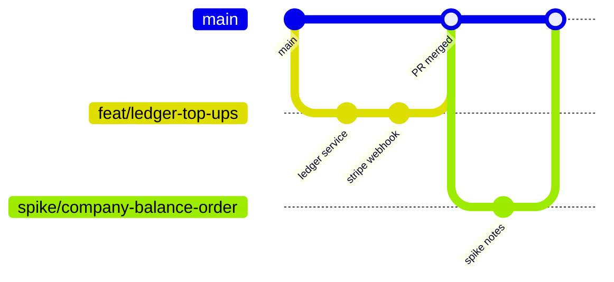

# Git workflow

## Branches

- `main` is always green: CI (lint, typecheck, tests, build) runs on every
  push and pull request. Turn on branch protection requiring those checks
  once the repo is on GitHub.
- Branch names: `feat/…`, `fix/…`, `docs/…`, `chore/…`, `spike/…`.
- Spike branches merge their write-up (in `docs/plans/spikes.md`) and any
  reusable code; throwaway code stays on the branch.

## Commits

[Conventional Commits](https://www.conventionalcommits.org/) with the module
as scope: `feat(gifts): claim a gift with an atomic lock`. The subject says
what changed; the body says why and anything a reviewer must know.

## Pull requests

Every PR:
- describes the change and how it was verified (commands run, pages checked);
- updates the docs it affects in the same PR;
- passes CI;
- contains **no secrets**: no connection strings, commercetools client
  secrets, Stripe keys or provider tokens. `.env*` files are gitignored;
  check `git diff --cached` before committing;
- for money or redemption code, gets a second reviewer.

## Releases

POC: every merge to `main` deploys to the one cloud environment (from M7).
Demo builds are tagged `demo-YYYY-MM-DD`.
