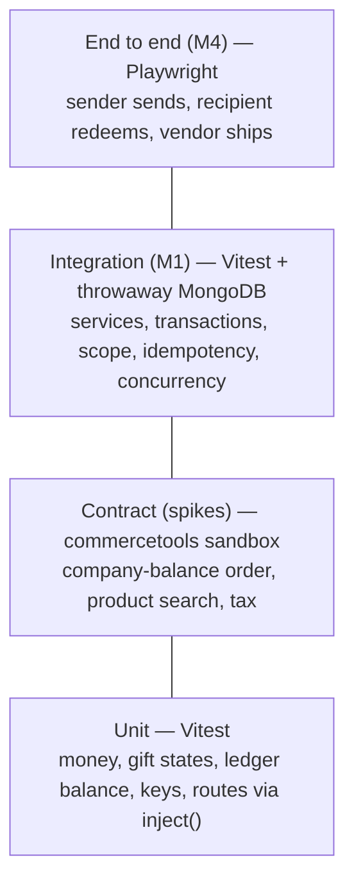

# Testing

**Status:** unit tests built for the scaffold (domain, ledger, db guards,
channels, logger, API health and meta, worker registry, seed and ct-setup
drafts). Integration and end-to-end layers arrive with M1 and M4.

```bash
pnpm test                                   # every package's unit tests
pnpm --filter @gifting/ledger test          # one package
pnpm --filter @gifting/api exec vitest run src/app.test.ts   # one file
```

## Layers



| Layer | Where | What it covers | Status |
| --- | --- | --- | --- |
| Unit | `packages/*/src/**/*.test.ts`, `services/*/src/**/*.test.ts`, `infra/*/src/**/*.test.ts` | Money helpers, gift state machine, idempotency keys, balance rule for every lifecycle, test-db guard, index list, channel registry, logger redaction, `/health` and `/v1/meta`, error shape, job registry, fictional seed data, ct-setup drafts | Built |
| Integration | `services/api/tests/integration/*.test.ts` | Each service against a throwaway `gifting_test_*` database: scope (another company, another team), transactions, duplicate idempotency keys, 50 parallel claims | Planned (M1) |
| Contract | `infra/ct-setup/tests/*.contract.ts` | Against the commercetools sandbox, run by hand, never in CI | Planned (spikes) |
| End to end | `e2e/*.spec.ts` | The three journeys, at phone width for the recipient | Planned (M4) |

## Rules

- Unit tests need no database and no network. CI runs them on every push.
- Integration tests create and drop their own `gifting_test_<time>_<random>`
  database. `assertTestDb()` refuses any other name before anything is
  written or dropped.
- commercetools is never called from CI. Code that calls it is tested with a
  fake client built from the SDK's types, plus the contract tests run by hand.
- Every guard has a test that proves it refuses: a second claim, a retried
  ledger entry, another company's gift, an over-budget item.
- Break what a test guards and watch it fail before trusting it.

## Money tests

The ledger is the riskiest code, so it gets property-style tests:

- For any mix of holds, releases, captures and fees, a redeemed gift nets to
  capture + fee, and an expired gift nets to zero.
- Replaying any entry list with duplicate idempotency keys never changes the
  balance (duplicates are refused upstream; `computeBalance` also ignores
  them).
- 50 parallel claims on one gift produce one `redeeming` gift (integration,
  M1) and one order (contract, spike 6).
