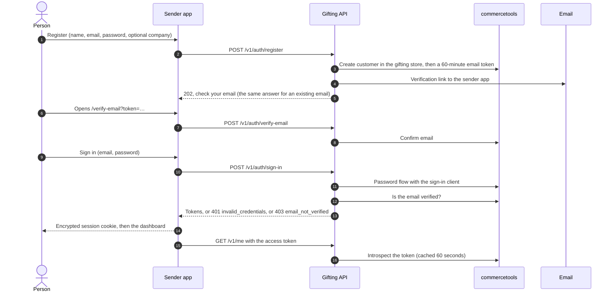

# M1: Register and sign in (B2C, commercetools customer accounts)

**Status:** Built; sign-in waits for the sign-in API client
**Agreed:** 29 Oct 2026 · **Built:** 29 Oct 2026

Replaces the [Auth0 sign-in plan](m1-sign-in.md). The why, and what the
probe of commercetools found, are in
[ADR 0015](../architecture/decisions/0015-commerce-customer-accounts.md).

## Goal

Anyone can register, verify their email from a link, and sign in to the
sender dashboard. Accounts are commercetools customers in the `gifting`
store, signed in with commercetools' OAuth 2.0 password flow, behind an
identity interface that other commerce platforms can implement. Login and
register only; the rest of the B2C change comes after.

## Flow

## Scope

| Part | What |
| --- | --- |
| API routes | `POST /v1/auth/register`, `/verify-email`, `/resend-verification`, `/sign-in`, `/refresh`, `/sign-out` (public, rate-limited); `GET /v1/me` (signed in) |
| Identity interface | `IdentityProvider` in the accounts module; `ct-identity.ts` for commercetools: register, find by email, email token, confirm, password flow, refresh, introspection, revoke |
| Email | A `Mailer`: SMTP (Mailpit locally, SendGrid later). If SMTP is unreachable outside production, it writes `.eml` files to `.data/outbox` |
| Rules | Password 10 to 128 characters, with a letter and a digit. Email trimmed and lowercased. Any domain. Terms must be accepted |
| Sender app | `/register`, `/register/check-email`, `/verify-email`, `/sign-in` (with the resend option when the email isn't verified), the dashboard, and sign-out from the account menu. Session in an encrypted http-only cookie, renewed in `proxy.ts` |
| Removed | Auth0: the SDK, the JWT check, `infra/auth0`, the settings, the no-access page and the Google button |

**Not in scope** (comes next): forgot or reset password, changing email,
and the B2C clean-up of companies, teams and vendors.

## Tests

API, with a fake identity provider and mailer. Each must be refused:
- registration with a weak password, a bad email, or the terms not
  accepted;
- an existing email gets the same `202`, and an "already registered" email
  instead of a token;
- an invalid or used verification token;
- a wrong password gets a generic `401`;
- an unverified email gets `403`, and the tokens are revoked;
- the sixth failed sign-in in 15 minutes gets `429`, before commercetools is
  called;
- `/v1/me` without a token, or with an inactive token, gets `401`;
- scope comes from the token, not the request;
- sign-out revokes both tokens;
- the API refuses a sign-in client with admin scopes.

**Guard check:** remove the verified-email check, then the rate limit, and
watch the tests fail.

**By hand:** register, open the link from the outbox or Mailpit, sign in,
see the dashboard, sign out.

## Prerequisite

**A sign-in API client in the Merchant Center:**
1. Settings → Developer settings → Create new API client, named
   `gifting-sign-in`.
2. Scope: **`manage_my_profile`** only.
3. Put its id and secret in the root `.env` as `CTP_SIGNIN_CLIENT_ID` and
   `CTP_SIGNIN_CLIENT_SECRET`.

## As built

**Built, as planned:**
- **`@gifting/domain`:** `registerInput`, `signInInput`, `passwordProblem`,
  `accountView` and `sessionTokens`. The app and the API share them.
- **API, in the accounts module:**
  - the `IdentityProvider` interface, and `ct-identity.ts` for commercetools
    (in-store customers, email tokens, the password flow, introspection,
    revocation, and the scope guard);
  - the rules in `service.ts`;
  - the routes, a fixed-window rate limiter, and the account emails;
  - `mail/mailer.ts`: SMTP, falling back to `.data/outbox` outside
    production.

  Route access is now `account` (default), `ops` (`OPS_EMAILS`) or
  `public`.
- **Sender app:**
  - `/register`, `/register/check-email`, `/verify-email` and `/sign-in`;
  - server actions for register, resend, sign-in and sign-out;
  - a session cookie encrypted with `jose`, renewed in `proxy.ts`;
  - the account menu signs out with a form post.
- **`@gifting/ui`:** `AuthCard`, and `UserMenu` with a sign-out action.
- **Removed:** the Auth0 SDK, the JWT check, the Business Unit member
  lookup in the API, `infra/auth0`, the no-access page, `SignInCard` and
  `GoogleIcon`.

**Found while building:**
- **With our admin client, a customer's password-flow token carries
  `manage_project`,** which is full project access. Narrower scopes are
  refused. So sign-in needs its own client with only `manage_my_profile`,
  and the API refuses to start without that.
- **The password flow signs in unverified customers.** The service refuses
  them, and revokes the tokens.
- **Docker wasn't running, so Mailpit wasn't either.** Hence the outbox
  fallback.

**Verified:**
- **API tests:** 21 for accounts, among them:
  - every refusal in the plan;
  - an existing email answering like a new one;
  - only the newest link working after a resend;
  - at most 3 emails an hour per address;
  - the scope guard.
- **Guard check:** each of these, removed in turn, failed its test, and all
  pass once restored:
  - the verified-email check;
  - the sign-in rate limit;
  - the generic duplicate answer;
  - the scope guard;
  - the ops check.
- **Against commercetools:**
  - the admin client is refused as a sign-in client;
  - registering creates an unverified store customer with its company
    name, and writes the verification email;
  - the link verifies, once;
  - registering again sends "already registered".

  The test customer was deleted.
- **In the browser:** the register form shows each rule's message, and
  sign-in reports that it isn't configured yet.
- **All checks:** lint, typecheck, 152 tests and the build pass.

**End to end, 29 Oct 2026**, once the `gifting-sign-in` client
(`manage_my_profile` only) was in `.env`:
1. Register.
2. Sign-in refused while unverified, with a resend button.
3. The link from the outbox.
4. "Your email is verified".
5. Sign in, and the dashboard with the name and company.
6. Page scripts can't read the session cookie.
7. Sign out, after which the dashboard redirects to sign-in.

The test account was deleted.

### Validation follow-up (29 Oct 2026)

Asked for by Shivam:
- **Passwords:** 10 to 128 characters, with an uppercase and a lowercase
  letter, a number and a special character, and never the email name.
  There's a live checklist under the field, and the rules are shared with
  the API.
- **Confirm password**, with a live "don't match" hint. The confirmation
  never leaves the app.
- **Show/hide and a Caps Lock warning** on every password field, on
  register and sign-in (`PasswordInput` in `@gifting/ui`).
- **Taken emails:** register answers `409 email_taken` with "Go to sign
  in". A taken email that isn't verified gets a fresh link. A record without
  a password counts as taken, and never gets a link (this fixed the
  verification email that Shivam's old company-setup record received).
- **Small things:**
  - names, email and terms are kept after a refused submit, and passwords
    are cleared;
  - an empty password says "Enter a password.";
  - focus starts on the first field;
  - the email field has the email keyboard, no autocapitalise and no spell
    check;
  - the right autofill hints;
  - a `success` token instead of a raw green.
- **Verified:**
  - 41 domain tests and 30 API tests;
  - guard checks on the taken-email answer and on passwordless records;
  - in the browser: the checklist, the toggle, the mismatch hint, a taken
    email (Shivam's), and the terms box staying ticked.

### Real email through Brevo (29 Oct 2026)

- **What:** the API also takes `SMTP_HOST`, `SMTP_PORT`, `SMTP_USER` and
  `SMTP_PASS`, so a provider login with an `@` needs no URL encoding. Brevo's
  free plan sends the account emails for development.
- **Verified:** an SMTP login check that sends nothing, then Shivam
  registered with a personal address and received the verification email.
- **What we learned:**
  - Brevo refuses SMTP from an unlisted IP (`525 Unauthorized IP address`)
    unless IP blocking is off.
  - An email from `@royalcyber.com` was accepted by Brevo but never arrived.
    That domain has DMARC `p=quarantine` and no Brevo DKIM, so Microsoft 365
    quarantines it. A company sender needs the domain authenticated in the
    provider first.
