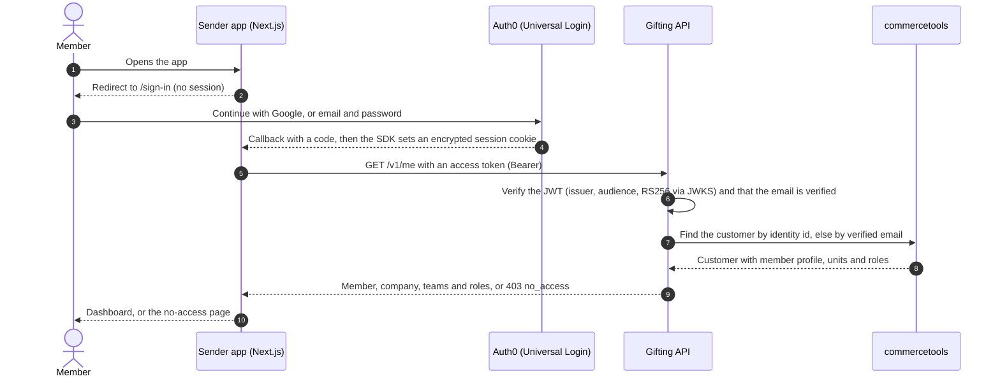

# M1: Sign-in, invitations and member access

**Status:** Superseded on 29 Oct 2026 by [M1: register and sign in](m1-register-sign-in.md). The product became B2C, and accounts moved to commercetools ([ADR 0015](../architecture/decisions/0015-commerce-customer-accounts.md)). Phase A was built against Auth0, and is kept here as a record.
**Agreed:** 28 Oct 2026

## Goal

Give company members, and our own ops staff, a solid way to sign in: with
Google or with an email and password, by invitation only. Every API call
should then know who is calling, which company and teams they belong to,
and what their role allows. Everything else in M1 to M7 (budgets,
campaigns, approvals) builds on this. It is POC package M1 1.2, plus the
company and invitation parts of 1.1.

## Decisions (agreed with Shivam, 28 Oct 2026)

| Decision | Choice | Why |
| --- | --- | --- |
| Identity provider | **Auth0, Free plan** ([ADR 0009](../architecture/decisions/0009-identity-provider.md), now accepted) | Free up to 25,000 monthly active users. Hosted login with Google and email and password; we never store passwords. No company Google account is needed to start |
| How people join | **Invite-only.** Ops creates a company and invites its owner; owners and admins invite colleagues. There is no public sign-up | A B2B product with sales-led onboarding. The prototype's "Start Gifting for Free" becomes "Talk to sales" |
| Which emails | **Work emails only.** Personal domains (gmail.com, outlook.com …) are refused, and invites must match the company's email domains | Each company is a business, and a domain check stops mistaken invites |
| Where companies, teams and members live | **commercetools**: Business Units, Associates and Associate Roles, as seeded ([ADR 0001](../architecture/decisions/0001-commerce-in-commercetools.md)) | Today's agreed design. Flagged for the [ADR 0013](../architecture/decisions/0013-commerce-adapters.md) discussion, which may move this to our database later |
| Who proves identity, who grants access | Auth0 proves who someone is. **Our API decides access**, from the commercetools member record | One place for membership and roles. Auth0 holds no company data |

## How it works

### In Auth0 (one free tenant per environment)

- **Applications:**
  - **Gifting Sender** (Regular Web Application): callback
    `http://localhost:3000/auth/callback`.
  - **Gifting Ops** (Regular Web Application): callback on port 3003.
  - Vendor later.
- **API "Gifting API"**, audience `https://api.gifting.local`, RS256. RBAC is
  on, with permissions in the access token. One permission, `ops:manage`,
  is given through an Auth0 role, `platform-ops`, to our ops staff.
- **Connections:**
  - Database (email and password) with **"Disable sign ups"** on;
    invitations create the users.
  - **Google.** Auth0's developer keys are fine for building. Our own Google
    OAuth client must replace them before any external demo, because the
    developer keys are for testing only and show Auth0 on the consent
    screen.
- **One post-login Action** (kept in `infra/auth0/actions/`) adds the
  user's `email` and `email_verified` to the access token as namespaced
  claims. Access tokens don't carry email by default.
- **Universal Login branding:**
  - our logo, primary colour `#2570C5` and the prototype's background;
  - password policy "Good" or stronger;
  - brute-force protection and breached-password detection, whatever the
    free plan offers.
- **Management API access** (a machine-to-machine application with
  `create:users`, `read:users`, `create:user_tickets`) for the API's
  invitations.

### In commercetools

- **Companies and teams:** Business Units (Company and Divisions), as seeded
  by `pnpm seed`.
- **Members:** Customers with `authenticationMode: ExternalAuth`, Associates
  on the units, and the roles `owner`, `admin`, `approver`, `sender`.
- **A new custom type `member-profile` on Customer:**
  - `identityIds`: a set of Auth0 `sub` values (one person may sign in with
    Google and with a password);
  - `status`: `invited`, `active` or `disabled`;
  - `invitedAt` and `invitedBy`.
- **`company-settings` gains `emailDomains`**, a set of the company's email
  domains.

### In the API (`services/api`)

- **`http/auth.ts`:** verifies the Bearer token with `jose` against Auth0's
  JWKS (issuer, audience, expiry, RS256 only).
- **`defineRoute` gains `auth`:** `"member"` (the default), `"ops"` (needs
  `ops:manage`) or `"public"` (only `/health` and `/v1/meta`). A route
  without a valid token gets `401 unauthenticated`.
- **The accounts module** resolves the caller:
  - look up the identity id in `member-profile.identityIds`;
  - otherwise, look up the verified email, which links a new sign-in
    method to an invited member;
  - first sign-in moves `invited` to `active`;
  - `disabled`, or not a member, gives `403 no_access`.

  The result is cached in memory for 60 seconds per `sub`, so not every
  request calls commercetools.
- **Request scope** (`companyKey`, `teamKeys`, roles) is built from that
  record, never from the request (CLAUDE.md "Scope and access").
- **Routes:**
  - `GET /v1/me`: name, email, company, teams and roles;
  - `GET /v1/members`: members of the caller's company;
  - `POST /v1/invitations`: owner or admin invites a colleague by email,
    role and team;
  - `POST /v1/invitations/{key}/resend`;
  - `POST /v1/members/{key}/disable`;
  - `POST /v1/ops/companies`, for ops: company name, email domains, first
    team, owner email. Creates the units and invites the owner.

### Invitations

1. **The API checks the email:** the domain must be a work domain and one
   of the company's `emailDomains`, and the person mustn't already be a
   member.
2. **It creates the commercetools Customer and adds the Associate** to the
   unit with the role (`member-profile.status = invited`).
3. **It creates the Auth0 database user** (random password, email not
   verified) and a **password-change ticket** (valid 7 days). Using the
   ticket sets their password and marks their email verified.
4. **It sends the invitation email** through the channel registry. A small
   SMTP email adapter is built now: Mailpit locally, SendGrid later. The
   email offers two ways in:
   - **"Continue with Google"**, for Google Workspace emails;
   - **"Set a password"**, the ticket link.
5. **On first sign-in** the verified email matches the invitation, and the
   member becomes active. Resending makes a new ticket. Invitations older
   than 14 days are shown as expired, and can be resent.

### In the apps

- **`@auth0/nextjs-auth0` v4** in the sender app (and ops). It needs:
  - a `proxy.ts` (Next.js 16) that mounts `/auth/*` and sends signed-out
    visitors to `/sign-in`;
  - a rolling 24-hour session, with a 7-day absolute limit;
  - server-side `getAccessToken()` for API calls.

  The browser never sees the access token, and never calls the API
  directly.
- **Screens**, built from shadcn/ui (the `login` blocks) in the
  prototype's look:

  | Screen | What it does |
  | --- | --- |
  | `/sign-in` | Wordmark, "Sign in to Gifting", **Continue with Google**, **Continue with email**, and "Access is by invitation. Ask your company admin, or talk to sales." |
  | `/invite` | "You've been invited to {company}" with both ways in |
  | `/no-access` | Signed in but not a member (or disabled). Shows the email, and offers sign out and "ask your admin" |
  | Header menu | Name, company and role; **Sign out** (ends the Auth0 session too) |
  | `/settings/members` | Members list (name, email, team, role, status). Owners and admins invite, resend and disable |
  | Ops `/companies`, `/companies/new` | Companies list; create a company and invite its owner |

- **The prototype's look in `@gifting/ui`:**
  - the shadcn tokens get the prototype's colours (primary `#2570C5`, ink
    `#012754`, line `#E2E9F2`), in light and dark;
  - Sora for headings and DM Sans for text, through `next/font`.

  It's a token change only, so every app gets it with no app-level styles.

### Configuration (`.env`, Secret Manager in the cloud)

| Variable | Used by | Notes |
| --- | --- | --- |
| `AUTH0_DOMAIN` | apps, api | The tenant, for example `gifting-dev.us.auth0.com` |
| `AUTH0_AUDIENCE` | apps, api | `https://api.gifting.local` |
| `AUTH0_SECRET` | each app | 32 random bytes; encrypts the session cookie. Secret |
| `APP_BASE_URL` | each app | `http://localhost:3000` for the sender app |
| `SENDER_AUTH0_CLIENT_ID`, `SENDER_AUTH0_CLIENT_SECRET` | sender | Secret |
| `OPS_AUTH0_CLIENT_ID`, `OPS_AUTH0_CLIENT_SECRET` | ops | Secret |
| `AUTH0_MGMT_CLIENT_ID`, `AUTH0_MGMT_CLIENT_SECRET` | api | Management API, for invitations. Secret |

`DEV_AUTH` is removed. Tests sign their own tokens instead.

## Scope

**Phase A: sign-in and access (about 3 to 4 days)**
- The Auth0 tenant set up from a checklist in `infra/auth0/README.md`, plus
  the post-login Action.
- Token verification, `auth` on routes, member resolution, request scope,
  and `GET /v1/me`.
- `member-profile` and `emailDomains` added in `ct-setup`. The seed gives
  demo members an identity link, so the demo users can sign in.
- The sender app: sign-in, sign-out, the no-access page, the header menu,
  and protected pages. The prototype tokens in `@gifting/ui`.

**Phase B: invitations and companies (about 3 to 4 days)**
- Invitations (API, Auth0 user and ticket, email), resend and disable.
- The members page in the sender app.
- Ops sign-in, and creating a company with its owner invite.
- The SMTP email adapter in `@gifting/channels`.

**Not in scope:**
- Company SSO (SAML/OIDC, later);
- multi-factor authentication;
- vendor sign-in (M4);
- changing a member's team or role (after M1);
- custom email templates in Auth0.

## Tests

API tests run against a local key pair and a fake JWKS, so they need no
Auth0. Each must be refused:
- no token, a bad signature, an expired token, the wrong audience or the
  wrong issuer give `401`;
- an `HS256` or `none` token gives `401`;
- an unverified email, a non-member or a disabled member gives
  `403 no_access`;
- another company's member or team, by key, gives `404`;
- a sender inviting, or an invite to a personal domain or to a domain
  outside the company's, is refused;
- an `ops` route without `ops:manage` gives `404`;
- inviting someone who is already a member is refused;
- re-accepting is a no-op: two sign-ins make one active member;
- Google and a password for the same verified email resolve to one member.

**Guard check:** remove the issuer check, then the company filter, and watch
the tests fail.

**By hand:**
- sign in with Google (developer keys) and with a password;
- accept an invitation from Mailpit;
- sign out;
- check the app at 390px.

## Prerequisites and risks

- **An Auth0 account and free tenant.** Someone on the team creates them at
  auth0.com with a work email; any email works, no Google account needed.
  Then share the tenant domain and client ids, with the secrets kept in
  `.env`. The setup steps are in `infra/auth0/README.md`.
- **The catalog PR** (`feat/ct-catalog-import`) creates the associate roles
  and seeds the Business Units this plan uses. Build from that branch, or
  after it merges.
- **Our own Google OAuth client before any external demo.** It needs a
  Google Cloud project under the company account (for example the paid GCP
  organisation, [ADR 0014](../architecture/decisions/0014-google-cloud.md)).
- **ADR 0013:** if the team moves companies and members to our database, the
  member lookup moves from commercetools to MongoDB. The API's accounts
  service hides where they live, so routes and screens don't change.
- **Free-plan limits** (organisations, Actions, email sending) are checked
  when the tenant is created. Auth0's built-in email provider is for testing
  only: verification and password emails need our SMTP (SendGrid) before
  real users.

## Docs to update

- [ADR 0009](../architecture/decisions/0009-identity-provider.md):
  accepted, Auth0.
- [features](../product/features.md): accounts are invite-only.
- [security](../architecture/security.md): sessions and tokens.
- [commercetools design](../architecture/commercetools.md):
  `member-profile` and `emailDomains`.
- [configuration](../technical/configuration.md): the Auth0 variables.
- [API reference](../technical/api.md).
- The build log, and this plan's **As built** section.

## As built

### Phase A (28 Oct 2026)

**Built, as planned:**
- **Commercetools:** `member-profile` on Customer (`identityIds`, `status`,
  `invitedAt`, `invitedBy`) and `emailDomains` on `company-settings`
  (`ct:apply`). The seed marks its 250 demo members active, and gives each
  company its domain.
- **`@gifting/domain`:** `MEMBER_ROLES`, `MEMBER_STATUSES`,
  `isPersonalEmail`, the `memberView` schema, `hasRole` and `primaryRole`.
- **API:**
  - `http/auth.ts` verifies tokens with `jose` 6.2.12: RS256 only, plus
    issuer, audience and expiry;
  - `defineRoute({ auth })` takes `member` (default), `ops` or `public`;
  - the accounts module has a pure `memberScope` (owners and admins reach
    every team; approvers and senders their own), a cached resolver, and a
    commercetools directory;
  - `GET /v1/me`.
- **Sender app:**
  - `@auth0/nextjs-auth0` 4.32.0;
  - `proxy.ts`: `/auth/*` routes, redirects to `/sign-in` keeping
    `returnTo`, and the access token renewed and saved;
  - a member-only route group, the dashboard with the account menu,
    `/sign-in`, `/no-access`;
  - Auth0 errors land back on `/sign-in`.
- **`@gifting/ui`:**
  - the prototype's colours (light, plus a derived dark);
  - DM Sans and Sora through `next/font`;
  - `SignInCard`, `GoogleIcon`, `UserMenu` and `Wordmark`, and
    `AppShell` actions.
- **`infra/auth0`:** a setup checklist and the post-login Action.

**Changed from the plan:**
- **`email_not_verified` is its own `403` code**, not `no_access`, so the
  page can say what to do.
- **Members are found by verified email only.** `identityIds` records every
  sign-in method, and Google and a password for the same email reach one
  member. Looking up by identity id first would add a query and gain
  nothing.
- **Each app reads its own `.env.local`.** The root `.env` holds
  commercetools and database secrets the apps must not have. App variables
  use the SDK's standard names (`AUTH0_CLIENT_ID` …), not
  `SENDER_AUTH0_CLIENT_ID`.
- **`pnpm member:add`** adds a real person to a company, so phase A can be
  tried before invitations exist. Work emails only. `--company-name` creates
  the company (with the email's domain and a General team) when its key is
  new. Royal Cyber (`royal-cyber`) was created this way, with Shivam as
  owner.
- **Without Auth0 settings, the API still starts.** Its routes that need
  sign-in answer `503 auth_not_configured`, and the sender app shows a
  notice on `/sign-in`.
- **Re-seeding leaves existing team units alone.** The Import API can't
  update a Division that inherits stores.

**Verified:**
- **API:**
  - 31 tests in `services/api`: 17 for sign-in and access, 6 for
    `memberScope`, and the 8 that were there. They cover:
    - 401 for no token, a bad signature, an expired token, the wrong
      audience or issuer, HS256 and alg none;
    - 403 for an unverified email, a non-member, a disabled member and a
      member in no company;
    - 404 for ops routes without `ops:manage`;
    - scope ignores the request body;
    - an invited member activates once;
    - Google and a password reach one member;
    - the 60-second cache;
    - 503 before Auth0 is configured.
  - Plus 6 for the member rules in `@gifting/domain`.
- **Guard check:** each of these, removed in turn, failed its test, and all
  pass once restored:
  - the issuer check;
  - the audience check;
  - the disabled-member check;
  - the verified-email check;
  - the ops permission check.
- **In commercetools:** the member queries were tried against the project
  (customer by email; units by associate; a company's teams), with a demo
  owner and a demo approver.
- **The built sender app, in the browser:**
  - `/` redirects to `/sign-in`, keeping `returnTo` on both buttons;
  - DM Sans and Sora load;
  - the prototype palette in light and dark;
  - the no-access page;
  - no sideways scroll at 390px.

**Not yet verified:** a real sign-in. That waits for the Auth0 tenant
(`infra/auth0/README.md`).
