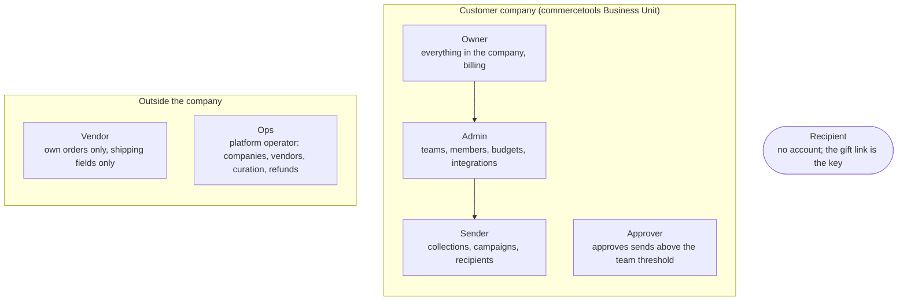

# Personas and roles

Six roles across three kinds of user: people at a customer company, vendor
staff, and our own operators. Recipients have no account at all; a gift link
is their only key.

Roles are commercetools Associate Roles on the company or team Business
Unit; the identity provider proves who the person is. An approver can't
approve their own campaign.

## Maya, people-ops lead (role: Admin, also Approver)

- Runs onboarding, birthdays and work anniversaries for 1,200 staff across
  six teams.
- **Needs:** gifts that send themselves on the right day, one budget per team,
  and a monthly statement finance accepts.
- **Frustrations:** spreadsheets of birthdays, collecting home addresses,
  gifts nobody wanted.
- **The platform gives her:** automated campaigns from the HR system, team
  budget accounts, approvals and statements.

## Arjun, account executive (role: Sender)

- Sends 20 to 40 gifts a month to prospects and customers.
- **Needs:** send a gift from Slack or with a link in two minutes, and know
  when it was opened and redeemed.
- **The platform gives him:** one-time campaigns, links and QR codes, a
  tracking dashboard and reminders that stop once the gift is redeemed.

## Dana, finance controller (role: Owner)

- Funds the account and closes the books every month.
- **Needs:** prepaid or invoice billing, no surprise charges, and spend by
  team and campaign.
- **The platform gives her:** top-ups, holds that show what's committed,
  true-up at claim, released funds on expiry, statements and exports.

## Sam, recipient (no account)

- Gets a gift by email, text, Slack or Teams, usually on a phone.
- **Needs:** a fast, trustworthy page, real choice and no prices on show.
  Their address goes to the shipper, not their employer.
- **The platform gives them:** the unwrap page in the company's colours, a
  collection to choose from, an address form and order tracking.

## Lee, vendor fulfilment (role: Vendor)

- Ships orders for one brand in the marketplace.
- **Needs:** a clear list of orders to fulfil, and a fast way to add tracking.
- **The platform gives them:** the vendor portal-lite with only their orders,
  mark-shipped with carrier and tracking, and CSV export.

## Priya, platform operator (role: Ops)

- Runs the marketplace for the practice or the client.
- **Needs:** onboard companies and vendors, curate platform collections, and
  fix money mistakes safely.
- **The platform gives her:** the ops admin. Every money correction is a
  ledger `adjustment` with a reason, never an edit.
