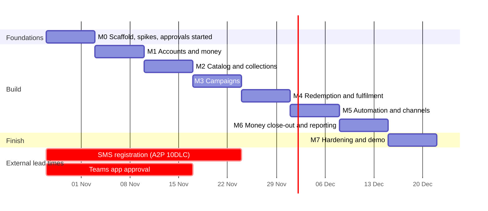

# Roadmap

The POC is built in eight weekly milestones, M0 to M7. Each ends at an exit
check that must pass before the next milestone depends on it. Durations are
estimates for a team of about 2.5 people working with AI assistance, not
commitments. Owners are suggestions to confirm.

**This file is updated with every milestone step**, together with
[features.md](features.md) and the README progress table.

_Last updated: 28 Oct 2026 (sender dashboard built ahead of M1 to M3; see [change 1](../plans/poc-plan.md#changes-after-agreement))._

## Where we are

Architecture v2 (multi-brand marketplace) is agreed and documented. The
monorepo scaffold exists: four apps, the API, the worker and the shared
packages, with CI. The next steps are the week-1 [spikes](../plans/spikes.md)
and starting the slow external approvals (SMS sender registration, the Teams
app). Then M1 starts.

| Status | Item | Milestone |
| --- | --- | --- |
| ✅ Done | Architecture v2 and the docs set | M0 |
| ✅ Done | Monorepo scaffold: apps, API, worker, packages, CI, seed data, commercetools drafts | M0 |
| ✅ Done | Sender dashboard slice: balance, catalog read, campaigns with estimate, approval and holds, on seed data ([plan](../plans/sender-dashboard.md)) | M0 (ahead) |
| Planned | Spikes 1 to 6 written up ([spikes](../plans/spikes.md)) | M0 |
| Planned | A2P 10DLC registration, Slack app and Teams bot submitted | M0 |
| Planned | Companies and teams as Business Units, identity, budget accounts, ledger, Stripe test top-ups | M1 |
| Planned | Collection rules, product search resolution, build-your-own collection UI | M2 |
| Planned | One-time and scheduled campaigns, estimates, approvals, holds, email, links and QR | M3 |
| Planned | Recipient experience, company-balance order, vendor routing, vendor portal-lite, tracking | M4 |
| Planned | Recipient directory, CSV dates, one HR system, milestone worker, SMS, Slack, Teams | M5 |
| Planned | Expiry releases, refunds, statements, reconciliation, dashboard and exports | M6 |
| Planned | Concurrency and ledger tests, security pass, demo script and data, cloud environment | M7 |

## Timeline

## Milestones and exit checks

| Milestone | Week | Exit check | Suggested owner |
| --- | --- | --- | --- |
| M0 Foundations | 1 | Spike results written up; the scaffold builds in CI | All, led by Shivam |
| M1 Accounts and money | 2 | A team is funded and its balance is correct | Shivam |
| M2 Catalog and collections | 3 | A $50 collection shows only eligible, in-stock items | Bhuvaneshwari |
| M3 Campaigns | 4 | An approved campaign holds funds and emails links | Shivam, Bhuvaneshwari |
| M4 Redemption and fulfilment | 5 | A gift becomes a vendor order and shows shipped | Chetan |
| M5 Automation and channels | 6 | A birthday gift sends itself through Slack | Shivam, Chetan |
| M6 Money close-out and reporting | 7 | The ledger reconciles to commercetools orders | Bhuvaneshwari |
| M7 Hardening and demo | 8 | End-to-end demo in the cloud environment | All |

## Decisions we're waiting on

| Decision | Blocks | Where |
| --- | --- | --- |
| Who operates the marketplace and contracts with vendors | Vendor onboarding beyond seed data, payouts | [Open questions](../business/open-questions.md) |
| Platform fee model | The `fee` entry amount (M4) | [Open questions](../business/open-questions.md) |
| Who pays shipping and tax | The hold formula (M3) | [Open questions](../business/open-questions.md) |
| Identity provider (Auth0 or Cognito) | M1 | [ADR 0009](../architecture/decisions/0009-identity-provider.md) |
| Which HR system first | M5 | [Open questions](../business/open-questions.md) |

## If a milestone slips

Cut in this order, and record each cut in the
[POC plan](../plans/poc-plan.md#changes-after-agreement):
1. HR-system sync becomes CSV only.
2. SMS and Teams demo as "submitted"; Slack and email carry the demo.
3. Build-your-own collections become platform collections only.
4. Statements become a CSV export.

The redemption path, the ledger and vendor routing are never cut. They are
the POC.

## After the POC

Vendor payouts and onboarding, live Stripe, tax provider (External tax mode),
public API and webhooks, thank-you notes, guaranteed-gift fallback, digital
gift cards and donations, swag and company stores, SSO, more countries and
currencies, and an AI gift assistant.
