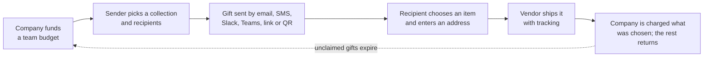

# Product vision

## The problem

Companies send thousands of gifts a year: to new hires, on work anniversaries
and birthdays, to prospects after a meeting, to customers at renewal. Today
someone guesses what each person wants, buys it, collects home addresses by
email and chases shipping. Half the gifts are wrong, the addresses are a
privacy problem, and finance can't see what was spent.

Merchants feel the other side. A client of ours, a cookie brand, wanted
corporate buyers to send "choose your tin" gifts to lists of recipients. It
wanted gift cards for consumers too. One merchant's catalog is too narrow for
most corporate buyers, though; they want one place for every occasion.

## The idea

**Let the recipient choose, and let the company pay only for what was
chosen.** A sender funds a budget, picks a curated collection ("anything up
to $50") and sends a link through whatever channel the recipient uses. The
recipient opens the gift, picks something they actually want, enters their
own address and gets tracking. The vendor that owns the item ships it. The
company is charged the real cost of what was picked, and anything unclaimed
comes back.

## Principles

1. **The recipient chooses.** Collections, not single products. Prices stay
   hidden; the recipient sees what they can have, not what it cost.
2. **Commerce stays in commercetools.** Catalog, stock, carts, orders, tax and
   shipments are commercetools' job. We build gifting, not a second commerce
   engine.
3. **Real orders with real money.** A redeemed gift is a real order with real
   totals, paid from the company's balance. Vendors, tax and reporting
   never see a fake $0 order.
4. **Exactly once, enforced by the database.** One gift, one order. Every
   dollar is held, captured or released exactly once. The rules live in
   unique indexes and atomic updates, not only in code paths.
5. **Adapters at every edge.** Channels, HR systems, vendors and payment
   providers plug in behind interfaces. Adding one never touches campaigns or
   gifts.
6. **An accelerator, not a one-off.** Everything is built so the practice can
   take it to the next client: configuration over code, and fictional demo
   data.

## What it is not (in the POC)

Vendor payouts, real card or ACH collection (Stripe runs in test mode), multi-currency,
SSO, swag and company stores, an AI gift assistant, digital gift cards and
donations. Each is designed for and listed in the
[feature inventory](features.md) as later work.

## How we will know it works

- A team can be funded, a $50 collection built and a campaign sent through
  every channel in under ten minutes.
- A recipient goes from link to placed order in under a minute on a phone.
- 50 parallel claims on one gift produce exactly one order and one capture.
- At any moment the ledger reconciles to commercetools order totals to the
  cent.
