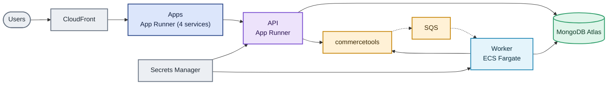

# Deployment

**Status:** local development built (Docker Compose). The cloud environment
is planned for M7.

## Environments

| Environment | What runs | Data | commercetools |
| --- | --- | --- | --- |
| Local | `pnpm dev` (apps and API), worker on demand, Docker: MongoDB Atlas Local, Mailpit | Local MongoDB | Sandbox project (from the spikes on) |
| CI | Lint, typecheck, unit tests, build, on every push to `main`, `qa`, `develop` and every PR | None | Never called |
| QA (M7), from `qa` | Four apps, API, worker | Its own MongoDB Atlas database | Sandbox project |
| POC demo (M7), from `main` | Four apps, API, worker | MongoDB Atlas (M10 or higher, for transactions and backups) | Sandbox or a dedicated POC project |

Branch flow and promotion: [git workflow](../engineering/git-workflow.md).

## POC cloud (planned)

- One container image per app and service, built in CI from `qa` (QA) and
  `main` (demo); the QA and demo environments are the same shape.
- The worker runs as a single long-lived task (jobs are idempotent, but one
  runner keeps schedules simple).
- Atlas network access is limited to the AWS egress addresses; the
  production database user for `ledgerEntries` gets insert and find only.
- The commercetools Subscription writes to SQS; the worker reads with a
  dead-letter queue after 5 attempts.

## Release

From M7, every merge to `qa` deploys to QA and every merge to `main` deploys
to the demo environment. Nothing deploys from `develop`.
Demo builds are tagged `demo-YYYY-MM-DD`.
