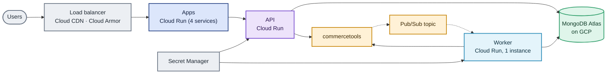

# Deployment

**Status:** local development built (Docker Compose). The cloud environment
is planned for M7, on Google Cloud
([ADR 0014](../architecture/decisions/0014-google-cloud.md)).

## Environments

| Environment | What runs | Data | commercetools |
| --- | --- | --- | --- |
| Local | `pnpm dev` (apps and API), worker on demand, Docker: MongoDB Atlas Local, Mailpit | Local MongoDB | Sandbox project (from the spikes on) |
| CI | Lint, typecheck, unit tests, build, on every push to `main`, `qa`, `develop` and every PR | None | Never called |
| QA (M7), from `qa` | Four apps, API, worker on Cloud Run | Its own MongoDB Atlas database (on GCP) | Sandbox project |
| POC demo (M7), from `main` | Four apps, API, worker on Cloud Run | MongoDB Atlas on GCP (M10 or higher, for transactions and backups) | Sandbox or a dedicated POC project |

Branch flow and promotion: [git workflow](../engineering/git-workflow.md).

## POC cloud on Google Cloud (planned)

Everything runs in **`us-central1` (Iowa)**. The commercetools project is
there too (`*.us-central1.gcp.commercetools.com`), and so is MongoDB Atlas
on GCP. Calls between them stay in one region.

| Need | Google Cloud service | Notes |
| --- | --- | --- |
| Run the four apps and the API | Cloud Run services | One container per app and service. The API and apps scale to zero in QA and keep one warm instance in the demo |
| Run the worker | Cloud Run service with one instance, CPU always allocated, internal ingress only | A single long-lived runner: jobs are idempotent, but one runner keeps schedules simple. Cloud Run worker pools are an option once generally available in our region |
| Public entry, HTTPS, caching | Global external Application Load Balancer with serverless NEGs, Google-managed certificates, Cloud CDN | Cloud CDN caches the apps' static assets |
| Rate limiting and protection | Cloud Armor | Rate limits on gift short codes and links, on top of the API's own limits |
| commercetools events | Pub/Sub | The commercetools Subscription writes straight to a Pub/Sub topic. The worker reads a pull subscription. After 5 failed deliveries a message goes to a dead-letter topic, which alerts |
| Secrets | Secret Manager | Mounted into Cloud Run as environment variables. `integrations.secretRef` names a Secret Manager secret |
| Container images | Artifact Registry | Built and pushed by GitHub Actions |
| CI to GCP access | Workload Identity Federation | GitHub Actions deploys with no service-account key files |
| Database | MongoDB Atlas on GCP, `us-central1` | Bought through Atlas (or the Google Cloud Marketplace). The POC allows only the Cloud NAT static egress IP. Production uses Private Service Connect |
| Outbound IP for Atlas | Direct VPC egress and Cloud NAT with a reserved static IP | One address to put on the Atlas access list |
| Email | SendGrid | Google Cloud has no transactional email service of its own. Mailpit locally |
| Logs, metrics and alerts | Cloud Logging, Cloud Monitoring, Error Reporting | The pino JSON logs are read as structured logs |
| Scheduled jobs | Agenda on MongoDB ([ADR 0011](../architecture/decisions/0011-jobs-on-mongodb.md)) | Cloud Scheduler is the alternative if we move off Agenda |

- **Same shape everywhere:** QA and the demo are the same shape, in separate
  GCP projects (`gifting-qa`, `gifting-demo`) under our paid organisation,
  with separate Atlas databases.
- **Each service has its own identity:**
  - every Cloud Run service runs as its own service account, with access
    only to its own secrets;
  - the worker alone may read the Pub/Sub subscription;
  - the commercetools Subscription's service account may only publish to
    its topic.
- **Least privilege in the database:** the production database user for
  `ledgerEntries` gets insert and find only.

## Release

From M7, every merge to `qa` deploys to QA and every merge to `main` deploys
to the demo environment. GitHub Actions builds the images, pushes them to
Artifact Registry and deploys new Cloud Run revisions. Nothing deploys from
`develop`. Demo builds are tagged `demo-YYYY-MM-DD`.
